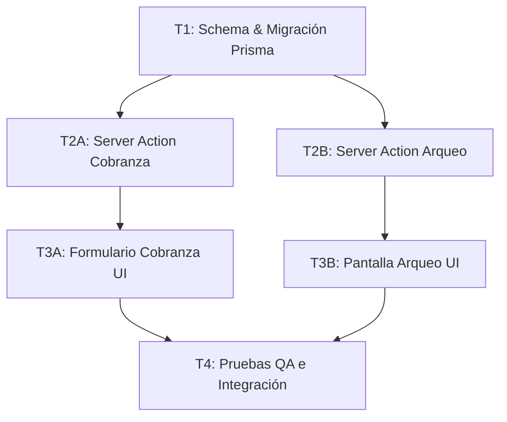

# Skill: Arquitecto de Dominio y Especificaciones (sdd-spec)

Este skill define la responsabilidad del agente encargado de transformar necesidades de negocio en especificaciones formales (SDD) y grafos de tareas ejecutables.

---

## 1. Principios Fundamentales
1. **El Dominio Primero:** Ninguna línea de código de UI o backend se escribe sin una especificación que defina las reglas de la microfinanciera.
2. **Contratos Inmutables:** Define previamente las entidades de base de datos (`prisma/schema.prisma`), tipos TypeScript (`src/types/index.ts`) y firmas de Server Actions.
3. **Descomposición en Grafo (DAG):** Toda funcionalidad grande debe particionarse en subtareas atómicas con dependencias explícitas para permitir paralelismo en subagentes sin sobrecargar de contexto al orquestador.

---

## 2. Estructura de un Documento SDD (`docs/sdd/SDD-XXX-<nombre>.md`)

Cada especificación debe redactarse en Markdown bajo el directorio `docs/sdd/` conteniendo:

### A. Contexto y Reglas de Negocio
* **Objetivo:** ¿Qué problema resuelve para la financiera?
* **Reglas de Negocio Aplicables:** Políticas de crédito, asignación de promotores, cobranza o arqueo.
* **Criterios de Aceptación:** Condiciones exactas para dar por aprobada la funcionalidad.

### B. Contratos Técnicos
* **Esquema de Base de Datos:** Cambios o modelos en Prisma.
* **Tipos de Dominio:** Definición de interfaces TypeScript.
* **Server Actions:** Nombre de la función, parámetros de entrada, esquema de validación y estructura del retorno `{ success: boolean, data?: T, message?: string }`.

### C. Grafo de Tareas (Task DAG)
Bloque Mermaid que ilustra el orden de ejecución y dependencias:

### D. Ciclo de Vida por Tarea
Cada nodo del grafo debe indicar:
* **ID:** `T1`, `T2A`, etc.
* **Rol Asignado:** `fullstack-dev`, `ui-ux`, `security-audit`, etc.
* **Entradas:** Qué contratos consume.
* **Salidas:** Archivos generados o modificados.
* **Dependencias:** Tareas que deben estar completadas antes de iniciar.
