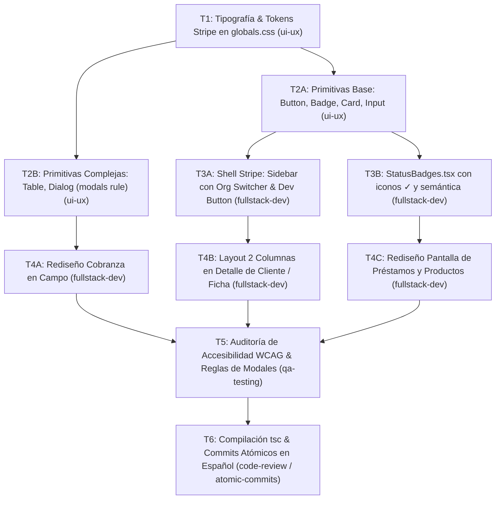

# SDD-001: Rediseño Institucional — Stripe Dashboard UI & shadcn/ui
## Financiera Impulso — Plataforma Operativa de Microfinanzas

> **Documento de Especificación y Lógica de Negocio (Spec-Driven Development)**  
> **Estado:** `LISTO PARA EJECUCIÓN (v1.1)`  
> **Agente Responsable del Spec:** `sdd-spec` / `ui-ux`  
> **Versión:** 1.1.0 (Evolución a Stripe Dashboard UI aprobada por el cliente)  
> **Referencia Visual Aprobada:** [`docs/design-system/preview.html`](file:///Users/gustavo/Documents/Personal/financiera-impulso/docs/design-system/preview.html)  
> **Manual de Diseño Oficial:** [`docs/design-system/DESIGN-SYSTEM.md`](file:///Users/gustavo/Documents/Personal/financiera-impulso/docs/design-system/DESIGN-SYSTEM.md)  
> **Fecha de Actualización:** 2026-10-22  

---

## 1. Visión y Lógica de Negocio (Dominio Microfinanciero)

### 1.1. Antecedentes y Evolución
La versión previa (v1.0) eliminó el modo oscuro y neones tipo gaming, pero pecó de un sobredimensionamiento tipográfico ("efecto lupa") y tablas genéricas que comprometían la densidad de información contable requerida en un Core Financiero.

Tras iteración visual con el cliente y validación de referencias reales de **Stripe Dashboard** (`dashboard.stripe.com`), se formalizó la arquitectura definitiva:
1. **Densidad y Elegancia Operativa:** Se erradica la apariencia de template genérico SaaS y la estética consumer/email (Google Material 3).
2. **Jerarquía Tipográfica Dual:** `Inter` para interfaces y lectura ejecutiva; `Source Code Pro` (o `Geist Mono`) con espaciado tabular (`tnum`) para cifras monetarias e IDs de clientes/contratos (`cli_...`).
3. **Distribución en 2 Columnas (30% / 70%):** Separación estricta entre la ficha del acreditado/aval a la izquierda y el flujo de cobranza/créditos a la derecha.

### 1.2. Directrices de Accesibilidad y Negocio
* **Estándar WCAG AAA:** Razón de contraste mínima de 7.0:1 para textos normales sobre fondos claros.
* **Superficies Sólidas:** Fondo blanco óptico (`#ffffff`), bordes sutiles hairline (`#e3e8ee`) y alternancias en `#f7f8f9`. Cero transparencias borrosas o brillos.
* **Preservación de Reglas del Workspace (`.agents/rules/`):**
  - **Modales (`modals.md`):** Tecla `Escape` habilitada, botón explícito Cancelar/Cerrar y **bloqueo estricto de cierre por clic en el backdrop** (sin `alert`/`confirm` nativos).
  - **Tiempo Real:** Server Actions con `unstable_noStore as noStore` obligatorio en consultas a base de datos.
  - **Asignación de Clientes (`client_assignment.md`):** Promotores restringidos a su cartera asignada; Administradores con vista global.

---

## 2. Contratos Técnicos Oficiales

### 2.1. Tokens Globales de Diseño (`src/app/globals.css`)
```css
@theme inline {
  --font-sans: 'Inter', -apple-system, BlinkMacSystemFont, 'Segoe UI', Roboto, sans-serif;
  --font-mono: 'Source Code Pro', monospace;

  /* Acción Stripe */
  --color-primary: #635bff;
  --color-primary-hover: #5146e5;
  --color-primary-subtle: #f4f3ff;

  /* Tintas */
  --color-foreground: #1a1f36;
  --color-text-secondary: #3c4257;
  --color-text-muted: #697386;
  --color-link: #0052cc;

  /* Superficies */
  --color-background: #ffffff;
  --color-surface-subtle: #f7f8f9;
  --color-border: #e3e8ee;
  --color-input: #e3e8ee;
  --color-ring: rgba(99, 91, 255, 0.35);

  /* Semántica Financiera */
  --color-success-bg: #e3fcef;
  --color-success-text: #00875a;
  --color-warning-bg: #fffae6;
  --color-warning-text: #b76e00;
  --color-danger-bg: #ffebe6;
  --color-danger-text: #de350b;
}
```

### 2.2. Primitivas shadcn/ui Requeridas (`src/components/ui/`)
* **`button.tsx`:** Añadir variante `stripe-actions` (`bg-[#635bff] hover:bg-[#5146e5] text-white rounded-[4px] h-[34px] px-3 text-[13px] font-medium`).
* **`badge.tsx`:** Soporte para pills semánticas (verde `#e3fcef` / `#00875a`, amarillo `#fffae6` / `#b76e00`, rojo `#ffebe6` / `#de350b`) y pills monospace para IDs con borde `#e3e8ee`.
* **`table.tsx`:** Cabeceras en $11.5\text{px}$ `#697386`, filas en $38\text{px}$, checkboxes alineados y números tabulares a la derecha.

---

## 3. Grafo de Tareas y Dependencias (Task DAG)



---

## 4. Matriz de Ejecución y Despacho en Herdr

| ID | Tarea | Rol Asignado | Depende de | Archivos Involucrados | Criterio de Éxito |
| :--- | :--- | :--- | :--- | :--- | :--- |
| **T1** | Tokens Stripe y Fuentes en `globals.css` | `ui-ux` | - | `src/app/globals.css`, `src/app/layout.tsx` | Fuentes Inter y Source Code Pro cargadas, variables `#635bff` activas |
| **T2A** | Primitivas Base (Button, Badge, Card, Input) | `ui-ux` | `T1` | `src/components/ui/{button,badge,card,input}.tsx` | Botón Acciones púrpura 34px, badges 4px/10px con contraste AAA |
| **T2B** | Primitivas Complejas (Table, Dialog) | `ui-ux` | `T1` | `src/components/ui/{table,dialog}.tsx` | Tabla con filas de 38px y checkboxes; Dialog con backdrop click bloqueado |
| **T3A** | Shell Stripe (Sidebar & Topbar) | `fullstack-dev` | `T2A` | `src/components/shared/{Sidebar,Navbar}.tsx` | Org Switcher, subenlaces anidados, botón inferior `>_ Desarrolladores` |
| **T3B** | Actualización de `StatusBadges.tsx` | `fullstack-dev` | `T2A` | `src/components/shared/StatusBadges.tsx` | Badges `Cobrado ✓`, `Al corriente`, `En mora` sincronizados con el core |
| **T4A** | Rediseño de Pantalla Cobranza | `fullstack-dev` | `T2B`, `T3B` | `src/app/(dashboard)/cobranza/page.tsx` | Tabla contable Stripe con cifras alineadas a la derecha y noStore |
| **T4B** | Layout 2 Columnas en Clientes | `fullstack-dev` | `T3A` | `src/app/(dashboard)/clientes/[id]/page.tsx` | Grid 30/70 con ficha de contacto, aval y créditos activos |
| **T4C** | Rediseño Préstamos y Productos | `fullstack-dev` | `T3A`, `T3B` | `src/app/(dashboard)/prestamos/page.tsx`, `productos/page.tsx` | Lista de créditos y formulario de productos alineados a Stripe |
| **T5** | Auditoría QA y Reglas de Negocio | `qa-testing` | `T4A, T4B, T4C` | Vistas operativas completas | Verificación de Escape en modales, touch targets $\ge 44\text{px}$, cálculos de mora |
| **T6** | Verificación TypeScript y Commits Atómicos | `code-review` / `atomic-commits` | `T5` | Todo el workspace | `npx tsc --noEmit` cero errores y commits atómicos con formato convencional |

---

## 5. Checklist de Verificación y Criterios de Aceptación

- [x] Fuentes `Inter` y `Source Code Pro` configuradas con OpenType `tnum`.
- [x] Variables CSS de Stripe Dashboard (`#635bff`, `#1a1f36`, `#3c4257`, `#697386`, `#e3e8ee`) en `globals.css`.
- [x] Sidebar con selector de organización, sub-enlaces jerárquicos y pie de desarrolladores.
- [x] Detalle de cliente con distribución en 2 columnas (30% / 70%).
- [x] Modales cumplen estrictamente con `.agents/rules/modals.md` (no cierre por backdrop).
- [x] Server Actions conservan `unstable_noStore as noStore`.
- [x] Compilación TypeScript (`npx tsc --noEmit`) sin advertencias ni errores.
- [ ] Commits atómicos unitarios en español sin atribuciones a IA (en proceso para T6).
