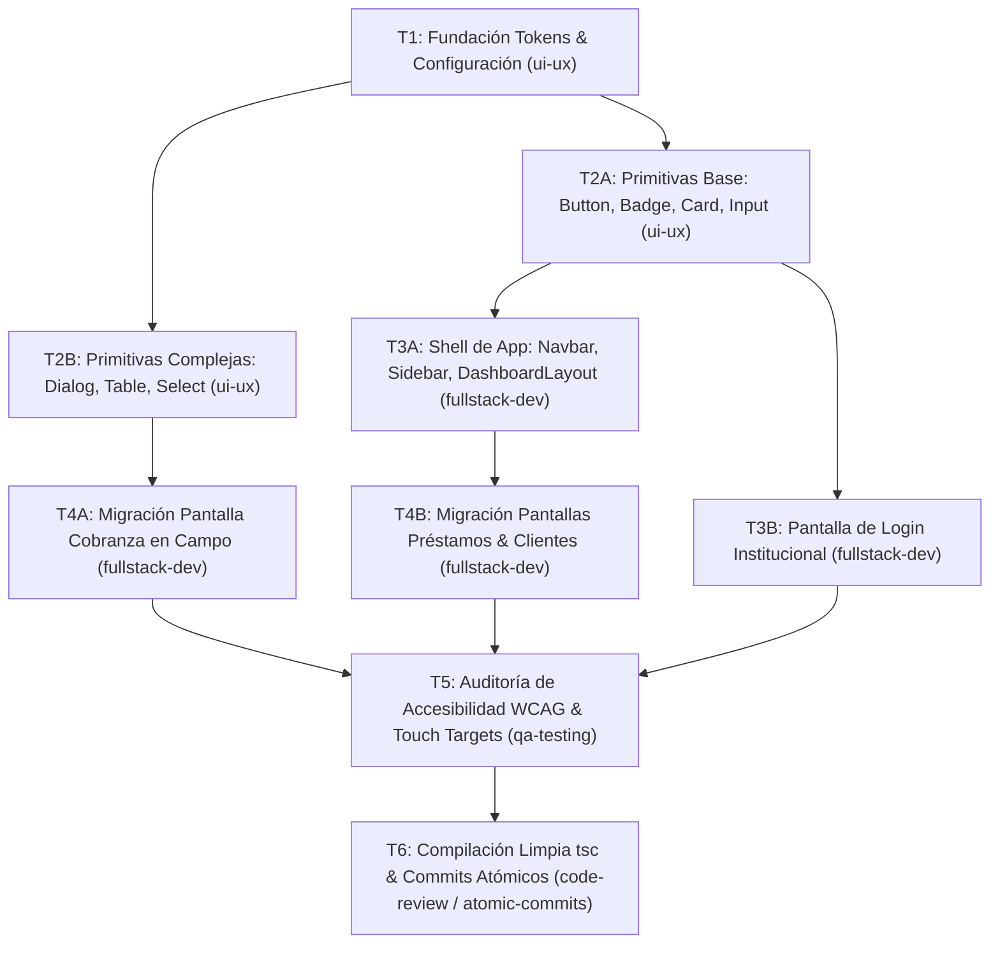

# SDD-001: Rediseño Institucional "Light-First" e Integración de shadcn/ui

> **Documento de Especificación y Lógica de Negocio (Spec-Driven Development)**  
> **Estado:** `COMPLETADO`  
> **Agente Responsable del Spec:** `sdd-spec`  
> **Fecha de Creación:** 2026-10-22  

---

## 1. Visión y Lógica de Negocio (Dominio Microfinanciero)

### 1.1. Problema Operativo / Necesidad del Cliente
El cliente principal y tomadores de decisiones de la financiera son adultos mayores. La interfaz previa presentaba tres barreras severas:
1. **Modo Oscuro con Glassmorphism y Neón:** Provoca fatiga visual acelerada, deslumbramiento y halos debido a la pérdida natural de sensibilidad al contraste por la edad. La estética tipo cripto/gaming resta credibilidad institucional a una financiera tradicional.
2. **Carga Cognitiva Alta:** Elementos visuales decorativos innecesarios (brillos, transparencias borrosas) que compiten con los datos críticos (saldos, cuotas vencidas, recibos).
3. **Ergonomía Deficiente:** Objetivos táctiles pequeños y micro-fuentes que dificultan la operación en escritorio y campo.

### 1.2. Directrices de Accesibilidad y Negocio
* **Estándar WCAG AAA (Adultos Mayores):** Razón de contraste mínima de 7.0:1 para textos normales y 4.5:1 para textos grandes.
* **Superficies Sólidas:** Eliminación total de `.glass-panel`, transparencias y sombras de neón (`.glow-emerald`, `.glow-indigo`). Toda tarjeta o contenedor es blanco sólido con bordes definidos.
* **Tipografía Base:** Mínimo de $16\text{px}$ (`text-base`) para el cuerpo de datos. Prohibido el uso de tamaños inferiores a $14\text{px}$ en información contable.
* **Áreas Táctiles Generosas:** Mínimo de $44 \times 44\ \text{px}$ para cualquier botón, selector o elemento interactivo.
* **Preservación de Reglas de Modales:** Todo diálogo debe soportar cierre con tecla `Escape`, botón explícito "Cancelar / Cerrar" y **bloqueo estricto de cierre por clic en el backdrop** (para prevenir pérdidas accidentales de datos en captura de formularios).

---

## 2. Contratos Técnicos

### 2.1. Tokens Globales de Diseño (`src/app/globals.css`)
Soporte nativo para Tailwind CSS v4 mediante `@theme inline` y variables CSS en `:root`:
* `--background`: `#f8fafc` (Slate 50)
* `--foreground`: `#0f172a` (Slate 900 - Contraste 16.5:1)
* `--card`: `#ffffff` (Blanco sólido)
* `--card-foreground`: `#0f172a`
* `--primary`: `#0f2942` (Azul Marino Banco Profundo)
* `--primary-foreground`: `#ffffff`
* `--muted`: `#f1f5f9` (Slate 100)
* `--muted-foreground`: `#334155` (Slate 700 - Contraste 8.3:1)
* `--border`: `#cbd5e1` (Slate 300)
* `--input`: `#cbd5e1`
* `--ring`: `#1d4ed8` (Blue 700 - Foco accesible)
* **Tokens Semánticos Financieros:**
  * `--success`: `#065f46` (Emerald 800 - Al corriente / Cobro exitoso)
  * `--destructive`: `#991b1b` (Red 800 - Mora / Vencido)
  * `--warning`: `#854d0e` (Amber 800 - Parcial / Pendiente)

### 2.2. Configuración de shadcn/ui (`components.json`)
```json
{
  "$schema": "https://ui.shadcn.com/schema.json",
  "style": "default",
  "rsc": true,
  "tsx": true,
  "tailwind": {
    "config": "",
    "css": "src/app/globals.css",
    "baseColor": "slate",
    "cssVariables": true,
    "prefix": ""
  },
  "aliases": {
    "components": "@/components",
    "utils": "@/lib/utils",
    "ui": "@/components/ui",
    "lib": "@/lib",
    "hooks": "@/hooks"
  },
  "iconLibrary": "lucide"
}
```

---

## 3. Grafo de Tareas y Dependencias (Task DAG)

Este grafo descompone la migración en ramas estrictamente paralelas y convergencias de verificación, diseñado para ejecución simultánea en panes de Herdr.



---

## 4. Matriz de Ejecución y Despacho en Herdr

Cada tarea se ejecutará en un pane físico dedicado según `.agents/rules/herdr_orchestration.md`:

| ID | Tarea | Rol Asignado | Depende de | Archivos Involucrados | Criterio de Éxito |
| :--- | :--- | :--- | :--- | :--- | :--- |
| **T1** | Fundación de Tokens y setup de shadcn | `ui-ux` | - | `globals.css`, `package.json`, `components.json` | Tokens cargados e instalación de dependencias |
| **T2A** | Primitivas Atómicas Base | `ui-ux` | `T1` | `src/components/ui/{button,badge,card,input}.tsx` | Componentes creados con tipografía $\ge 16\text{px}$ y touch target $\ge 44\text{px}$ |
| **T2B** | Primitivas Complejas y Modales | `ui-ux` | `T1` | `src/components/ui/{dialog,table,select}.tsx` | `Dialog` con backdrop click bloqueado y soporte Escape |
| **T3A** | Shell de Aplicación y Navegación | `fullstack-dev` | `T2A` | `src/components/shared/{Navbar,Sidebar}.tsx`, `(dashboard)/layout.tsx` | Menú lateral y barra superior en paleta clara de alto contraste |
| **T3B** | Pantalla de Acceso (Login) | `fullstack-dev` | `T2A` | `src/app/(auth)/login/page.tsx` | Formulario centrado, fondo limpio y botones claros |
| **T4A** | Pantalla de Cobranza en Campo | `fullstack-dev` | `T2B` | `src/app/(dashboard)/cobranza/page.tsx` | Tabla y tarjetas de cobro sin glassmorphism, botones grandes |
| **T4B** | Pantallas de Préstamos y Clientes | `fullstack-dev` | `T3A` | `src/app/(dashboard)/{prestamos,clientes}/page.tsx` | Directorio y cartera migrados a tarjetas blancas sólidas |
| **T5** | Auditoría de Accesibilidad y Borde | `qa-testing` | `T4A`, `T4B`, `T3B` | Toda la UI renderizada | Verificación WCAG AAA, teclado y navegación senior |
| **T6** | Cierre de Calidad y Commits Atómicos | `code-review` / `atomic-commits` | `T5` | Workspace completo | `npx tsc --noEmit` cero errores y commits atómicos en español |

---

## 5. Checklist de Verificación y Aceptación

- [x] Cero transparencias `.glass-panel` o brillos `.glow-*` en todo el proyecto.
- [x] Textos con contraste superior a 7.0:1 sobre fondos claros.
- [x] Botones de cobro y acciones críticas con altura mínima de $44\text{px}$ a $48\text{px}$.
- [x] Modales no se cierran al hacer clic en el backdrop.
- [x] Compilación TypeScript (`npx tsc --noEmit`) con 0 errores.
- [x] Commits atómicos registrados y subidos a `origin/main`.
