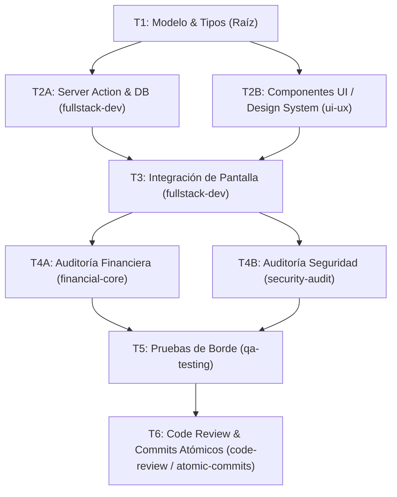

# SDD-[NUM]: [Nombre Corto de la Funcionalidad]

> **Documento de Especificación y Lógica de Negocio (Spec-Driven Development)**  
> **Estado:** `BORRADOR` | `APROBADO` | `EN_PROGRESO` | `COMPLETADO`  
> **Agente Responsable del Spec:** `sdd-spec`  
> **Fecha de Creación:** YYYY-MM-DD  

---

## 1. Visión y Lógica de Negocio (Dominio Microfinanciero)

### 1.1. Problema Operativo / Necesidad
*Describir en lenguaje funcional qué dolor resuelve esta funcionalidad para el administrador, los promotores de campo o la dirección.*

### 1.2. Reglas del Negocio Aplicables
* **Políticas de Crédito y Cobranza:** *(Ej. cuotas fijas, prelación de mora -> interés -> capital, abono mínimo de $100)*.
* **Horarios y Cortes Operativos:** *(Ej. corte estricto de caja a las 16:00 hrs)*.
* **Control de Acceso y Rutas:** *(Ej. Promotor restringido a su cartera; Administrador con vista global)*.

### 1.3. Criterios de Aceptación Funcionales
- [ ] Criterio 1: ...
- [ ] Criterio 2: ...
- [ ] Criterio 3: ...

---

## 2. Contratos Técnicos

### 2.1. Persistencia (`prisma/schema.prisma`)
*Detallar los modelos nuevos o modificados, o indicar si no aplica.*
```prisma
// Ejemplo de campos requeridos
model Entidad {
  id        String   @id @default(uuid())
  // campos requeridos con tipos explícitos
}
```

### 2.2. Tipos de Dominio (`src/types/index.ts`)
*Definir las interfaces TypeScript estrictas (cero `any`).*
```typescript
export interface NuevaEntidad {
  id: string;
  // campos requeridos
}
```

### 2.3. Server Actions (`src/app/actions/`)
*Definir firma exacta, validación de inputs, uso de `noStore()` y respuesta estandarizada.*
```typescript
// Firma esperada
export async function registrarAccionAction(
  input: InputDTO
): Promise<{ success: boolean; data?: ResultadoDTO; message?: string; error?: string }>;
```

---

## 3. Grafo de Tareas y Dependencias (Task DAG)

Este grafo define qué tareas pueden ejecutarse en **paralelo** mediante subagentes en Herdr y cuáles son estrictamente **secuenciales**.



### Matriz de Ejecución por Tarea

| ID | Tarea | Agente / Rol | Depende de | Contexto Requerido (Archivos) | Salida Esperada |
| :--- | :--- | :--- | :--- | :--- | :--- |
| **T1** | Contratos de Base de Datos y Tipos | `sdd-spec` / `fullstack-dev` | - | `schema.prisma`, `types/index.ts` | Modelos y tipos compilables |
| **T2A** | Server Actions & Transacciones | `fullstack-dev` | `T1` | `src/app/actions/`, Prisma | Acciones con `noStore()` y RBAC |
| **T2B** | Componentes de Interfaz & Estados | `ui-ux` | `T1` | `src/components/`, Tailwind v4 | UI con skeletons, modales y a11y |
| **T3** | Integración y Estado Zustand | `fullstack-dev` | `T2A`, `T2B` | `src/store/`, pantalla destino | Pantalla funcional conectada |
| **T4A** | Auditoría de Fórmulas y Cálculos | `financial-core` | `T3` | `financialCalculators.ts` | Cuadre exacto al centavo |
| **T4B** | Auditoría de Seguridad & PII | `security-audit` | `T3` | Server Actions, Sesión | Verificación RBAC y no fugas PII |
| **T5** | Pruebas de Casos de Borde | `qa-testing` | `T4A`, `T4B` | Toda la funcionalidad | Matriz de pruebas aprobada |
| **T6** | Revisión Final y Commits Atómicos | `code-review` / `atomic-commits` | `T5` | Workspace completo | `tsc` limpio y commits atómicos |

---

## 4. Matriz de Casos Límite y Reglas de Calidad

### 4.1. Reglas Financieras (`financial-core`)
- [ ] No existen desfases de centavos en la última cuota.
- [ ] La mora se aplica previa al interés y capital.
- [ ] Abono parcial mínimo de $100 validado (o excepción de liquidación total).

### 4.2. Experiencia e Interfaz (`ui-ux`)
- [ ] Validaciones de formularios desplegadas de arriba hacia abajo.
- [ ] Modales cierran con `Escape`, fondo bloqueado y sin alerts nativos.
- [ ] Estados de carga (Skeleton) y vacío (Empty State) presentes.

### 4.3. Seguridad y Privacidad (`security-audit`)
- [ ] Server Actions validan sesión y rol correspondiente.
- [ ] Promotores no pueden acceder ni cobrar créditos fuera de su cartera.
- [ ] No se filtran datos sensibles (CURP, INE, passwords) en el cliente.

---

## 5. Checklist de Verificación y Cierre Técnico

- [ ] **Compilación TypeScript:** `npx tsc --noEmit` completado con cero errores.
- [ ] **Linters:** `npm run lint` sin advertencias críticas.
- [ ] **Impacto en Grafo:** Verificado con `codegraph impact` sin efectos colaterales no deseados.
- [ ] **Commits Atómicos:** Registrados siguiendo Conventional Commits en español sin atribuciones a IA.
